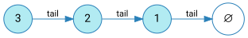
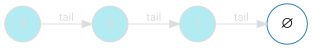
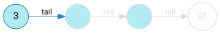

[English version (origin)](https://nrinaudo.github.io/recschemes/recursive_data_types.html)

[Назад](./introduction.md) | [Оглавление](./index.md) | [Дальше](./structural_recursion.md)

Before we can talk about recursion schemes, we need to start at the beginning. The very first step is to understand what recursive data types are.

You probably already know about recursive functions - function that call themselves. Recursive data types are the same: types that contain themselves.

The simplest one I can think of is the humble linked list - which proper functional programmers call the _cons_ list because why not.



The simplest possible list is the empty one, which we call `Nil`:




A non-empty list is a `Cons`, which is composed of:

- the first value in the list, which we call the `head`.
- a reference to the rest of the list, which we call the `tail`.



`tail` is the recursive part: a non-empty list contains a smaller list, which might be empty or non empty.

This list can be easily encoded in Scala - we'll make it monorphic to make things even simpler:

```scala
sealed trait List

case class Cons(
  head: Int,
  tail: List
) extends List

case object Nil extends List
```

And here's how you create values of that type:

```scala
val ints: List =
  Cons(3, Cons(2, Cons(1, Nil)))
```

It's not great - you have to squint a little bit to see where your data is. Value creation is always a little bit cumbersome when working with recursive data types, but there are solutions for this that we'll discuss a little bit later.

Now that we know what recursive data types are, our next step is to do interesting things with them.

[Назад](./introduction.md) | [Оглавление](./index.md) | [Дальше](./structural_recursion.md)

This work is licensed under a <a rel="license" href="https://creativecommons.org/licenses/by/4.0/">Creative Commons Attribution 4.0 International License</a>.